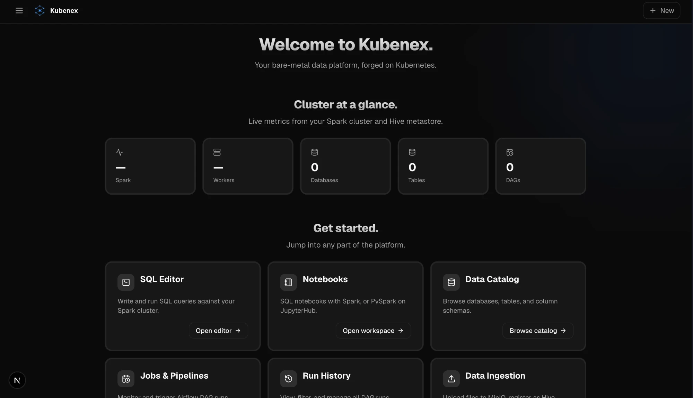
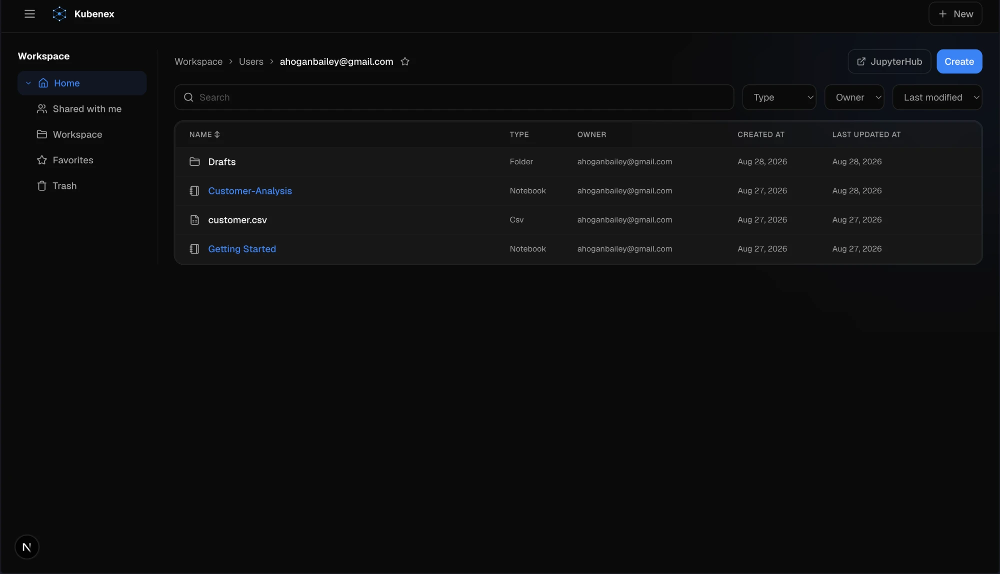
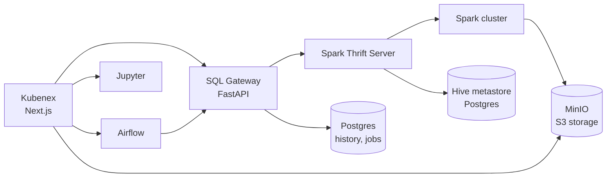
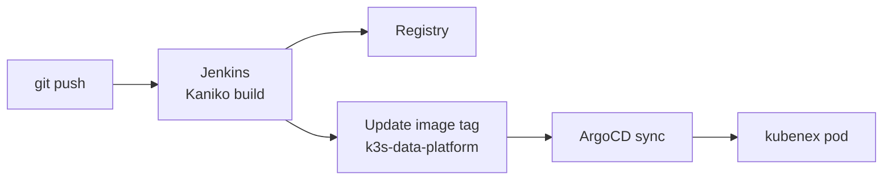

<p align="center">
  
</p>

<h1 align="center">Kubenex</h1>

<p align="center">A Databricks-style web UI for a self-hosted data platform on a bare-metal k3s cluster.</p>



## What it is

Kubenex is the front end for an open-source data platform that runs on three
mini PCs at home. It gives one place to query, explore, schedule, and load
data, in the style of Databricks and Snowflake.

Kubenex does not store or process data itself. Each page calls a service in
the cluster: Spark, the Hive metastore, MinIO, Airflow, or Jupyter.

This is a learning project. Its goal was to understand how a lakehouse
platform fits together by building one from open-source parts.

## Features

| Feature | What it does |
|---|---|
| **SQL Editor** | Runs SQL on Spark. Shows results as a table or as a bar, line, or area chart. |
| **Query History** | Records every statement from every page, with status, rows, and duration. |
| **Notebooks** | SQL and Python cells with result tables. A **Schedule** button turns a notebook into an Airflow job. |
| **Data Catalog** | Browses databases, tables, columns, and sample rows from the Hive metastore. Shows table lineage derived from query history. |
| **Create Table** | Builds a table from a column list, or registers files already in MinIO. Shows the DDL before it runs. |
| **Storage** | Browses MinIO buckets. Uploads, previews, and downloads files. Turns a CSV, JSON, Parquet, or ORC file into a table in one step. |
| **Jobs and Runs** | Lists Airflow DAGs and their runs. Triggers, pauses, and resumes them. |
| **Compute** | Shows the Spark master and its workers. |
| **Workspace** | Organizes notebooks and files in folders, with favorites and trash. |



## Architecture



- **SQL Gateway** (`deploy/sql-gateway`): a small FastAPI service. It turns
  HTTP requests into Thrift calls to Spark. It also stores query history and
  scheduled jobs in Postgres.
- **Scheduling**: the app writes a job row to Postgres. A factory DAG in
  Airflow turns each row into a DAG. The web app needs no Kubernetes
  credentials to schedule work.
- **Storage**: Spark reads and writes MinIO directly over `s3a://`. Tables are
  Parquet, CSV, JSON, or ORC files that you own.

More detail is in [docs/](docs/README.md).

## Tech stack

- **App**: Next.js 16, React, TypeScript, Tailwind CSS v4
- **Platform**: k3s, Apache Spark 3.5, Hive metastore, MinIO, Apache Airflow 2.10, JupyterHub, PostgreSQL 16
- **Delivery**: Jenkins (Kaniko builds), in-cluster Docker registry, ArgoCD (GitOps)

## Run locally

```bash
cp .env.example .env.local   # then fill in the values
npm install
npm run dev
```

Open <http://localhost:3000>.

The defaults in `.env.example` are in-cluster service names. From a laptop,
use addresses that the laptop can reach, such as node IPs and NodePorts.
See [docs/homelab.md](docs/homelab.md).

## Deploy



The Kubernetes manifests and the platform services live in the
[`k3s-data-platform`](https://github.com/AmanHogan/k3s-data-platform)
repository. Secrets are never in git. They are created in the cluster with
`kubectl create secret`, and the Deployment reads them with `secretKeyRef`.

## Documentation

| Page | Topic |
|---|---|
| [docs/data-platform.md](docs/data-platform.md) | How the platform fits together: storage, catalog, tables, Spark |
| [docs/sql-execution.md](docs/sql-execution.md) | How SQL runs: SQL Gateway, Thrift Server, Spark |
| [docs/python-execution.md](docs/python-execution.md) | How Python cells run: Jupyter kernel over WebSocket |
| [docs/homelab.md](docs/homelab.md) | The cluster: hardware, network, workloads, failure modes |
