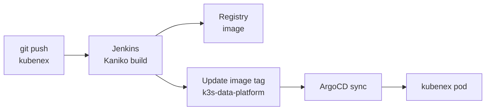

# Kubenex Documentation

Kubenex is a web UI for a self-hosted data platform on a k3s cluster. The app
does not store or process data itself. Each page calls a service in the
cluster.

## Pages in this folder

| Page | Topic |
|---|---|
| [data-platform.md](data-platform.md) | **Start here.** How the platform fits together: storage, catalog, tables, Spark |
| [homelab.md](homelab.md) | The cluster: hardware, network, workloads, failure modes |
| [python-execution.md](python-execution.md) | How Python notebook cells run (Jupyter kernel over WebSocket) |
| [sql-execution.md](sql-execution.md) | How SQL runs (SQL Gateway, Thrift Server, Spark) |

## Services behind Kubenex

| Kubenex feature | Service it calls | Route |
|---|---|---|
| SQL Editor, SQL cells | SQL Gateway, then Spark Thrift Server | `/api/sql` |
| Python cells | Jupyter server | `/api/execute` |
| Catalog | SQL Gateway (metastore queries, and query history for lineage) | `/api/catalog` |
| Storage | MinIO (S3) | `/api/storage` |
| Data Ingestion | MinIO for the upload, then SQL to create the table | `/api/ingest` |
| Jobs and Pipelines, Runs | Airflow (DAG list, runs, trigger, pause) | `/api/jobs`, `/api/runs` |
| Scheduling a notebook | SQL Gateway job table, read by an Airflow factory DAG | `/api/scheduled-jobs` |
| Compute | Spark master | `/api/compute` |
| Query History | SQL Gateway history table | `/api/history` |

## Where the pieces live

| Repository | Contents |
|---|---|
| `kubenex` (this repository) | The Next.js app and the SQL Gateway source (`deploy/sql-gateway`) |
| `k3s-data-platform` | Kubernetes manifests for the platform services and for Kubenex, and the ArgoCD applications. The Airflow DAG `kubenex_scheduled_jobs` is only in the cluster (ConfigMap `airflow-dags`), not in git. |

## Deploy path



Secrets are never in git. The `kubenex-secrets` Secret is created in the cluster
with `kubectl`, and the Deployment reads it with `secretKeyRef`.

## Local development

```bash
cp .env.example .env.local   # then fill in the values
npm run dev
```

Service URLs in `.env.example` default to in-cluster names. From a laptop, use
addresses that the laptop can reach. See [homelab.md](homelab.md).
