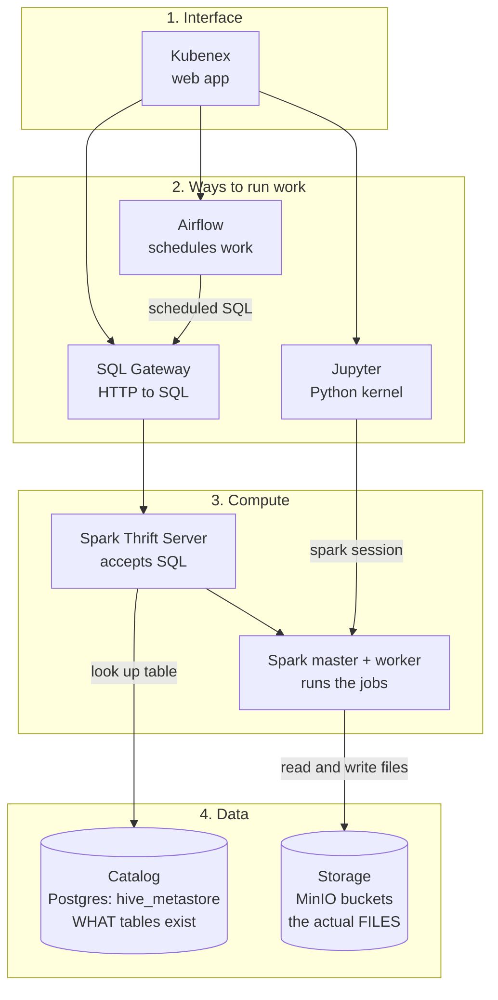
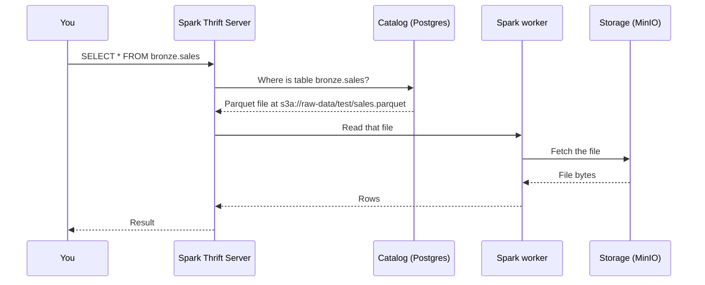
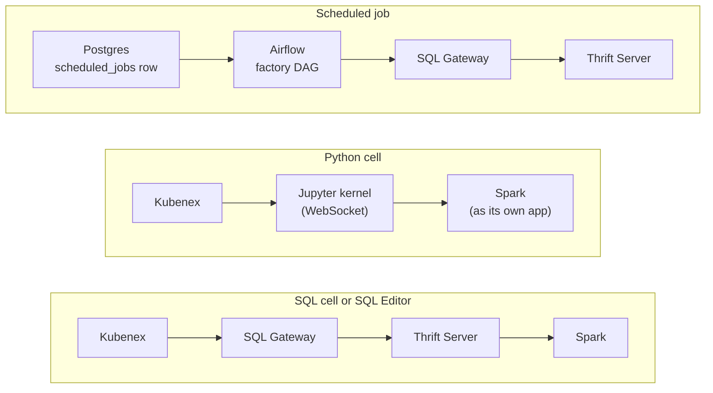

# Data Platform Overview

How the pieces of the platform fit together, and what each one does. Read this
page first. The other pages go into detail:
[python-execution.md](python-execution.md),
[sql-execution.md](sql-execution.md),
[homelab.md](homelab.md).

## The big picture

The platform has four parts. Each part does one job.

| Part | What it is | Where it runs |
|---|---|---|
| Interface | The Kubenex pages you use | Your laptop, or the `kubenex` pod |
| Ways to run work | Three doors into Spark: SQL, Python, and scheduled jobs | `sql-gateway`, `jupyterhub`, `airflow` pods |
| Compute | Spark reads and processes data | `spark-thrift`, `spark-master`, `spark-worker` pods |
| Data | Files, plus a catalog that describes them | `minio` and `postgres` pods |

Nothing stores data inside Spark. Spark only reads and writes files in MinIO.

## Three things people mix up

| Thing | What it is | Example |
|---|---|---|
| **Storage** | Files in a MinIO bucket | `s3a://raw-data/test/sales.parquet` |
| **Catalog** (Hive metastore) | A list of table definitions in Postgres. It holds no data. | "`bronze.sales` has these 4 columns, is Parquet, and is at that path" |
| **Table** | A name in the catalog that points to storage | `bronze.sales` |

A **table is a catalog entry that points to files**. Deleting the entry does not
always delete the files (see [External and managed](#external-and-managed-tables)).

## What happens when you run `SELECT * FROM bronze.sales`

You never write the file path in a query. The catalog already knows it.

## Names

`bronze.sales` has two parts: `database.table`. In Spark, "database" and
"schema" mean the same thing.

| Snowflake | Spark here | Example |
|---|---|---|
| database | catalog (only one: `spark_catalog`) | not written in queries |
| schema | database | `bronze`, `silver`, `gold`, `default` |
| table | table | `sales` |
| virtual warehouse (compute you pick) | none. The Spark cluster is the only compute. | not chosen |

- A name with no database, such as `sales`, uses the current database. It starts
  as `default`. `USE bronze;` changes it.
- There is no warehouse to select. Every query uses the same Spark cluster.

## External and managed tables

| Kind | Who picks the file location | `DROP TABLE` does |
|---|---|---|
| External | You, with `LOCATION 's3a://...'` | Removes the catalog entry. **Keeps the files.** |
| Managed | Spark, under `s3a://processed-data/warehouse` | Removes the entry **and deletes the files** |

`bronze.sales` is external. The upload page in Kubenex also creates external
tables (`CREATE EXTERNAL TABLE ... LOCATION ...`). `gold.revenue` is managed:
its definition has no `LOCATION`.

## Bronze, silver, gold

Three databases used as layers. This is a naming convention. Nothing enforces
it, and any table can be in any database.

| Layer | Meaning | Tables now |
|---|---|---|
| `bronze` | Raw data as it arrived | `sales`, `orders` |
| `silver` | Cleaned data | `customers`, `test_csv` |
| `gold` | Summaries for reports | `revenue` |

`default` also exists. Buckets in MinIO: `raw-data`, `processed-data`,
`backups`, `mlflow-artifacts`.

The Airflow DAG `medallion_etl` is a **placeholder**. Its three tasks only print
a message. It moves no data, so it did not build the silver or gold tables.

## The three ways to run work

- **SQL** goes through the gateway to the Thrift Server. The gateway also records
  each statement in query history. See [sql-execution.md](sql-execution.md).
- **Python** runs in a Jupyter kernel. The kernel has its own Spark session,
  separate from the Thrift Server. See [python-execution.md](python-execution.md).
- **Scheduled jobs** are SQL only. Creating a job writes a row to Postgres. An
  Airflow DAG (`kubenex_scheduled_jobs`) reads the rows and makes one DAG for
  each. Each DAG task sends one statement to the SQL Gateway.

## Two Spark applications share two cores

The Spark worker has 2 cores. The Thrift Server and the Jupyter kernel are two
separate Spark applications, and each needs a core.

| Application | Cores |
|---|---|
| Thrift Server (SQL) | 1 (`spark.cores.max=1`) |
| Jupyter kernel (Python) | the remaining 1 |

If both cores are in use, a new Spark job waits. It shows
`Initial job has not accepted any resources` in the logs.

## Loading a file

1. On the Data Ingestion page, choose a file.
2. Kubenex uploads it to a MinIO bucket (`raw-data` by default).
3. Kubenex runs `CREATE EXTERNAL TABLE db.table USING <format> LOCATION 's3a://...'`
   through `/api/sql`.
4. The table is now in the catalog and you can query it.

The upload page accepts CSV, Parquet and JSON. Spark can also read ORC from
SQL. There are no Delta or Iceberg libraries, so there is no `MERGE` and no
time travel.

## Glossary

| Term | Meaning |
|---|---|
| Hive metastore | The catalog of table definitions. Here it is a Postgres database. |
| Thrift Server | A Spark service that accepts SQL over the Hive protocol |
| `s3a://` | How Spark addresses S3-style storage. MinIO is the S3 store here. |
| Kernel | A running Python process inside Jupyter |
| DAG | An Airflow workflow: tasks and the order they run |
| Medallion | The bronze, silver and gold layer naming convention |
