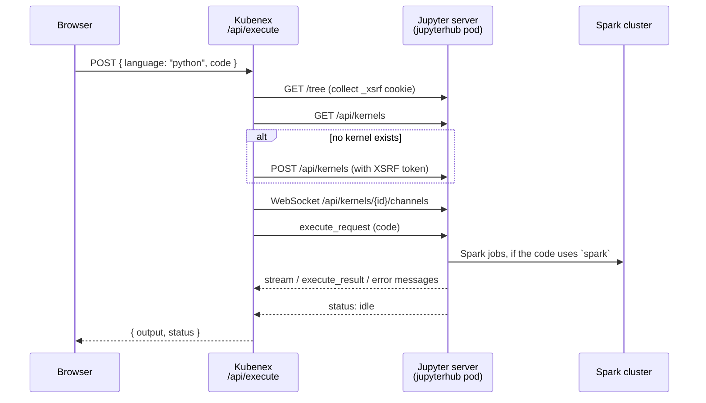

# Python Execution

How a Python cell in the Notebooks page runs. Kubenex has no Python runtime of
its own. It sends the code to a Jupyter server in the cluster and returns the
output.

Source: [`src/app/api/execute/route.ts`](../src/app/api/execute/route.ts)

## Flow

## Steps

1. The browser sends the code to `POST /api/execute` with `language: "python"`.
2. Kubenex requests a page from Jupyter and reads the `_xsrf` cookie. Jupyter
   rejects any state-changing request without this token (HTTP 403).
3. Kubenex lists the kernels. A kernel is a running Python process. Kubenex
   reuses the first one. If none exists, it starts a `python3` kernel.
4. Kubenex opens a WebSocket to the kernel and sends an `execute_request`
   message.
5. The kernel sends messages back on the same socket:

   | Message | Meaning | Kubenex does |
   |---|---|---|
   | `stream` | Printed text | Adds it to the output |
   | `execute_result`, `display_data` | Value of the last expression | Adds the `text/plain` form |
   | `error` | Exception | Adds the traceback with color codes removed and sets `status: "error"` |
   | `status` = `idle` | The request is finished | Closes the socket and returns |

Stock Jupyter has no REST endpoint that runs code and returns the result. The
WebSocket is the only way.

## The `spark` variable

The `jupyterhub` pod writes an IPython startup script before it starts Jupyter:
`~/.ipython/profile_default/startup/00-spark-session.py`. IPython runs it in
every new kernel. It builds a `SparkSession` named `spark` that connects to the
Spark master and to MinIO (S3A). Cells can use `spark` without any setup.

The script is part of `platform/jupyterhub/jupyterhub.yaml` in the
infrastructure repository (`k3s-data-platform`), not in this repository.

## Configuration

| Variable | Default | Purpose |
|---|---|---|
| `JUPYTER_URL` | `http://jupyterhub.data-platform.svc.cluster.local:8000` | Base URL of the Jupyter server |
| `JUPYTER_TOKEN` | empty | Sent as `Authorization: token ...` and as a WebSocket query parameter. Leave empty when the server has token auth off. |

When you run `npm run dev` on a laptop, set `JUPYTER_URL` to an address that
the laptop can reach. The in-cluster default only works from inside the cluster.

## Limits

- **One shared kernel.** All notebooks and cells use the same kernel. A
  variable that one cell sets is visible to every other cell. Two notebooks can
  overwrite each other's variables.
- **State is temporary.** Restarting the `jupyterhub` pod deletes the kernel,
  its variables, and the Spark session. The next Run starts a new kernel.
- **30-second limit.** A cell that runs longer returns a timeout error. The
  kernel can keep running the code after the error.
- **Spark needs a free core.** The Spark worker has 2 cores. The Thrift Server
  is capped to 1 core (`spark.cores.max=1`) so the notebook session can get the
  other one. If no core is free, a Spark job waits and the cell times out.
- **No interrupt.** Kubenex does not send an interrupt to a running cell.

## Errors

| Message | Cause |
|---|---|
| `JupyterHub not reachable (...)` | Kubenex cannot reach `JUPYTER_URL`, or Jupyter returned an error status |
| `Failed to start Python kernel (...)` | Jupyter refused to create a kernel |
| `WebSocket connection to the kernel failed` | The socket could not open |
| `Python execution timed out after 30s` | No `idle` message within 30 seconds |
| `NameError: name 'spark' is not defined` | The kernel started without the startup script |
