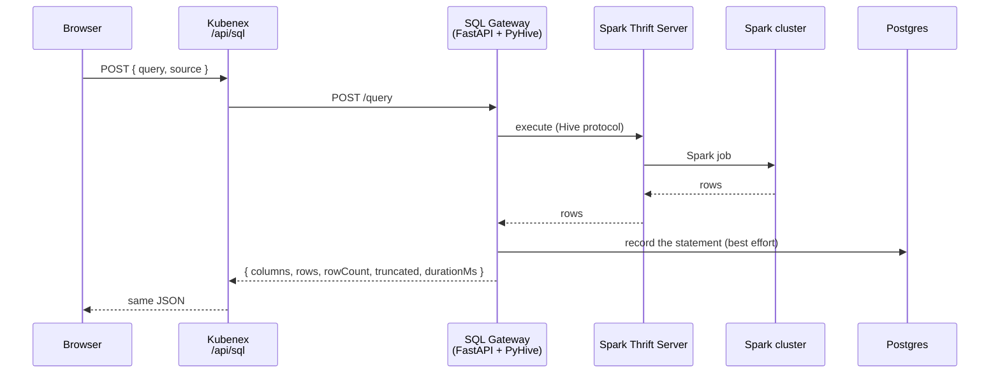

# SQL Execution

How a SQL statement runs, from the SQL Editor or from a SQL cell in a notebook.

Sources:
[`src/app/api/sql/route.ts`](../src/app/api/sql/route.ts),
[`deploy/sql-gateway/app.py`](../deploy/sql-gateway/app.py)

## Why there is a gateway

The Spark Thrift Server speaks the Hive binary protocol. A browser or a
Next.js route cannot use that protocol. The SQL Gateway is a small FastAPI
service. It accepts JSON over HTTP and talks to the Thrift Server with PyHive.

## Flow

A SQL cell in a notebook goes through `/api/execute` first. That route calls
`/api/sql` with `source: "notebook"`. See [python-execution.md](python-execution.md)
for the Python path, which does not use the gateway.

## Response

| Field | Meaning |
|---|---|
| `columns` | Column names. The gateway removes the `table.` prefix that PyHive adds. |
| `columnTypes` | Spark type of each column |
| `rows` | Array of objects. Every value is a string, or `null`. |
| `rowCount` | Number of rows returned |
| `truncated` | `true` if the result has more rows than the row limit |
| `durationMs` | Run time in milliseconds |

A statement with no result set (`CREATE`, `INSERT`, and similar) returns empty
`columns` and `rows` and `rowCount: 0`. This is a success.

On an error, the gateway returns HTTP 400 with `{ "error": "..." }`. Kubenex
passes that message to the browser.

## Query history

Every statement that passes through `/query` is recorded in Postgres. This
includes statements from the SQL Editor, from notebooks, and from ingest jobs.
The `source` field tells them apart. If Postgres is not reachable, the query
still runs. Only the history record is lost.

The Query History page and the lineage view read this data.

## Gateway endpoints

| Method | Path | Purpose |
|---|---|---|
| `POST` | `/query` | Run a statement |
| `GET` | `/history` | Recent executions, newest first |
| `GET` | `/jobs` | List scheduled jobs |
| `POST` | `/jobs` | Create a scheduled job |
| `DELETE` | `/jobs/{id}` | Delete a scheduled job |
| `GET` | `/health` | Health check |

## Configuration

| Variable | Default | Purpose |
|---|---|---|
| `SQL_GATEWAY_URL` or `THRIFT_PROXY_URL` | `http://sql-gateway.data-platform.svc.cluster.local:8080` | Gateway base URL |
| `THRIFT_HOST` | `spark-thrift.data-platform.svc.cluster.local` | Thrift Server host, sent to the gateway |
| `THRIFT_PORT` | `10000` | Thrift Server port |

When you run `npm run dev` on a laptop, set `SQL_GATEWAY_URL` to an address that
the laptop can reach.

## Limits

- **Row limit.** The gateway returns up to a fixed number of rows and sets
  `truncated: true` when there are more.
- **Spark needs a free core.** The Thrift Server holds 1 of the 2 worker cores
  (`spark.cores.max=1`). A second Spark application, such as a notebook
  session, uses the other core.
- **Values are strings.** The gateway converts every value to a string.
  `columnTypes` still reports the real Spark type of each column.
